# 🚀 Enterprise Azure DevOps Production Platform

**Multi-Stage CI/CD • Azure Landing Zone (Terraform) • Zero-Trust DevSecOps • AKS Microservices • Prometheus & Grafana Observability**

---

## 🏛️ Platform Architecture Overview

This repository contains the end-to-end production blueprint for an **Enterprise Azure Cloud Platform**, combining declarative **Terraform (HCL)** infrastructure provisioning with automated **Azure DevOps YAML pipelines** and **Azure Kubernetes Service (AKS)** orchestration.

```mermaid
graph LR
    classDef dev fill:#1e293b,stroke:#38bdf8,stroke-width:2px,color:#f8fafc;
    classDef sec fill:#31102f,stroke:#f43f5e,stroke-width:2px,color:#f8fafc;
    classDef cloud fill:#1e1b4b,stroke:#818cf8,stroke-width:2px,color:#ffffff;
    classDef ops fill:#064e3b,stroke:#10b981,stroke-width:2px,color:#f8fafc;

    A[👨‍💻 Developer Commit]:::dev --> B[🔍 SonarQube & Secret Scan]:::sec
    B --> C[🏗️ Docker Multi-Stage Build]:::dev
    C --> D[🛡️ Trivy Container Scan]:::sec
    D --> E[📦 Push to Azure ACR]:::cloud
    E --> F[🌍 Terraform Landing Zone]:::cloud
    F --> G[☸️ AKS Helm Deployment]:::ops
    G --> H[📊 Prometheus & Grafana]:::ops
```



---

## 📂 Core Platform Modules & Capabilities

| Module / Pillar | Key Technologies | Engineering Scope |
| :--- | :--- | :--- |
| **1. Azure Landing Zone (IaC)** | `Terraform` `HCL` `Azure Blob State` | Hub-and-spoke VNet topology, NSGs, Azure Key Vault, ACR, and production AKS clusters |
| **2. Multi-Stage CI/CD Pipelines** | `Azure DevOps` `YAML` `Git` | Automated build, test, security gating, and environment promotion (Dev → QA → Prod) |
| **3. Zero-Trust DevSecOps** | `Trivy` `SonarQube` `RBAC` `Key Vault` | Shift-left static code analysis, container vulnerability scanning, and managed identities |
| **4. Container Orchestration** | `Docker` `AKS` `Helm` `NGINX Ingress` | Auto-scaling microservices (HPA), rolling updates, and zero-downtime deployments |
| **5. Full-Stack Observability** | `Prometheus` `Grafana` `Azure Monitor` | Real-time cluster telemetry, custom alerting rules, and golden-signal dashboards |

---

## 🛠️ Quick Start & Deployment Workflow

```bash
# 1. Navigate to the Terraform Landing Zone directory
cd Azure-devops-production-platform

# 2. Initialize & validate Terraform configuration
terraform init
terraform fmt -check
terraform validate

# 3. Preview infrastructure execution plan
terraform plan -out=tfplan
```

---
*Maintained by **Mahesh Potdar** (`@Maahesh24`) — Cloud & DevOps Engineer*
